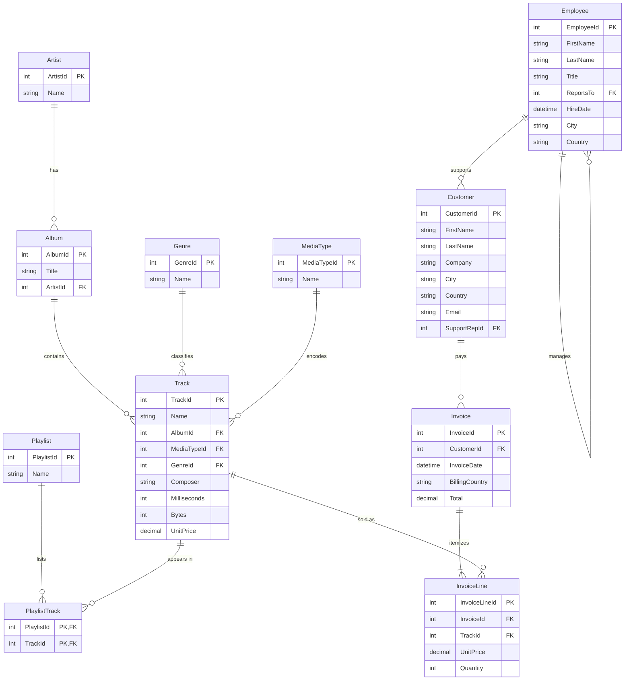

# 🗄️ Chinook.db schema

`Chinook.db` is a sample SQLite database for a digital music store. The SQL agent in L1, L6 and `sql_agent2.ts` queries it. It has 11 tables in four groups.



> GitHub renders the diagram. In an editor without Mermaid support, the tables below have the same information.

## Tables

### 🎵 Music catalog

| Table | Rows | What it is | Key columns |
|---|---:|---|---|
| `Artist` | 275 | Bands and musicians | `ArtistId`, `Name` |
| `Album` | 347 | One album by one artist | `AlbumId`, `Title`, `ArtistId → Artist` |
| `Track` | 3,503 | A song. This is the central table. | `TrackId`, `Name`, `AlbumId → Album`, `GenreId → Genre`, `MediaTypeId → MediaType`, `Composer`, `Milliseconds`, `Bytes`, `UnitPrice` |
| `Genre` | 25 | Rock, Jazz, Metal, … | `GenreId`, `Name` |
| `MediaType` | 5 | File format, such as MPEG or AAC | `MediaTypeId`, `Name` |

### 📃 Playlists

| Table | Rows | What it is | Key columns |
|---|---:|---|---|
| `Playlist` | 18 | Named playlists | `PlaylistId`, `Name` |
| `PlaylistTrack` | 8,715 | Join table linking playlists and tracks (many-to-many) | `PlaylistId → Playlist`, `TrackId → Track` (composite PK) |

### 👥 People

| Table | Rows | What it is | Key columns |
|---|---:|---|---|
| `Employee` | 8 | Store staff. `ReportsTo` points to another employee, which forms the org chart. | `EmployeeId`, `FirstName`, `LastName`, `Title`, `ReportsTo → Employee`, `HireDate`, address and contact fields |
| `Customer` | 59 | Buyers. Each one is assigned a support rep. | `CustomerId`, `FirstName`, `LastName`, `Company`, `Country`, `Email`, `SupportRepId → Employee`, address and contact fields |

### 💰 Sales

| Table | Rows | What it is | Key columns |
|---|---:|---|---|
| `Invoice` | 412 | One purchase by a customer | `InvoiceId`, `CustomerId → Customer`, `InvoiceDate`, `BillingCountry` (and other billing address fields), `Total` |
| `InvoiceLine` | 2,240 | One track on an invoice | `InvoiceLineId`, `InvoiceId → Invoice`, `TrackId → Track`, `UnitPrice`, `Quantity` |

## Common join paths

These are the paths the agent usually needs:

- **Track → artist:** `Track → Album → Artist`
- **Revenue per track, genre or artist:** `InvoiceLine → Track (→ Genre / Album → Artist)`, summing `UnitPrice * Quantity`
- **Revenue per customer or country:** `Invoice → Customer`, summing `Invoice.Total`, or group by `Invoice.BillingCountry`
- **Sales per employee:** `Invoice → Customer → Employee` (via `SupportRepId`)
- **What's on a playlist:** `Playlist → PlaylistTrack → Track`

## Gotchas

- Table names are **singular** and **PascalCase**: `Track`, not `tracks`.
- Prices are on both `Track.UnitPrice` (list price) and `InvoiceLine.UnitPrice` (price when sold). Use `InvoiceLine` for revenue.
- `Track.AlbumId` and `Track.GenreId` can be NULL, so use `LEFT JOIN` if you need every track.
- Durations are in milliseconds. Divide by 60000 to get minutes.

## Explore it yourself

```sh
sqlite3 Chinook.db ".tables"
sqlite3 Chinook.db ".schema Track"
sqlite3 -header -column Chinook.db "SELECT * FROM Genre LIMIT 5"
```
